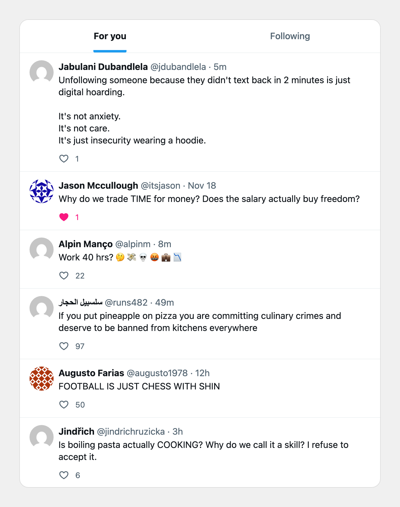
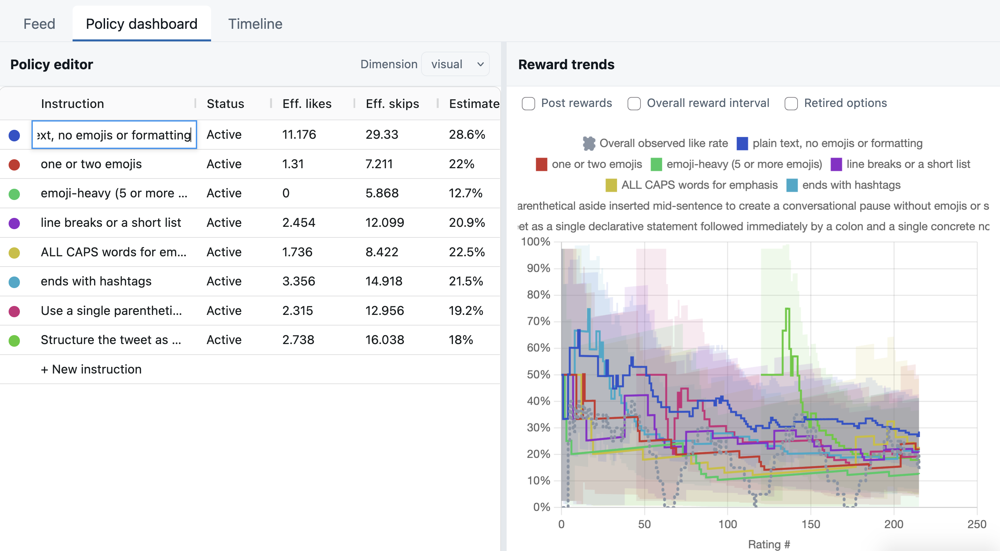

# LATER: Language Arms for Thompson-based Evolving Recommendation



**What if users could own their recommendation systems, audit why they suggest content, and write the rules those systems explore?**

LATER is a self-hostable proof of concept for personalization from sparse feedback. The demo is a synthetic Twitter/X feed that starts without an account or imported history. **The LLM proposes and follows readable instructions; a bandit tests which instructions work using likes and skips.**

## Inspect and edit your feed

The **Analytics** dashboard is central to the experiment: can users see what their recommender has learned and change the rules it explores?



- **Edit the rules.** Add, rewrite, or retire instructions, and override the effective likes and skips that guide future recommendations.
- **See what the system knows.** Compare estimated like rates and 95% credible bands over time against the overall observed like rate.
- **Audit changes.** The timeline shows which posts were served and rated, how the estimates changed, and why policies were retired. Overrides do not rewrite past ratings.

## How it works

- **Multi-armed bandit on readable suggestion policies.** [Thompson sampling](https://proceedings.neurips.cc/paper_files/paper/2011/hash/e53a0a2978c28872a4505bdb51db06dc-Abstract.html) selects instructions for the LLM to follow. Feedback on the generated post updates the bandit. The LLM proposes new options as the bandit retires weak ones, without fine-tuning the model.
- **Factored action space.** Each post combines a topic, style, visual format, and mood. One rating updates each selected option, sharing evidence across combinations without modeling interactions.

LATER combines existing techniques to generate posts from immediate binary feedback. It does not rank existing posts, optimize long-term outcomes, or establish how many ratings are enough.

## Related research

- [Factored Bandits](https://arxiv.org/abs/1807.01488) (2018) studies compositional actions under limited feedback.
- [GAMBITTS](https://arxiv.org/abs/2505.16311) and [Prompt Optimization with Logged Bandit Data](https://arxiv.org/abs/2504.02646) (2025) study feedback mediated by generated outputs. LATER uses simpler online updates that credit the selected instructions.
- [Promptbreeder](https://proceedings.mlr.press/v235/fernando24a.html) (2024) evolves prompts through iterative evaluation. [Bonsai](https://doi.org/10.1145/3772318.3791855) (2026) lets users shape their social feeds through natural-language intentions.

## Run it

Install [uv](https://docs.astral.sh/uv/getting-started/installation/). From the repo root, create `.env` with `OPENAI_API_KEY=your-key` to use OpenAI. For local inference, start an OpenAI-compatible server with structured output (e.g. [Ollama](https://ollama.com/) with `ollama pull qwen2.5:7b`) and set:

```dotenv
OPENAI_BASE_URL=http://127.0.0.1:11434/v1
OPENAI_API_KEY=ollama
LATER_MODEL=qwen2.5:7b
```

Ratings and preferences are saved locally. A local model keeps inference on your machine; browser avatars load from Gravatar.

```sh
uv run later-web --profile demo  # http://127.0.0.1:8000
```

- **Browser:** Install [Bun](https://bun.com/) for the automatic frontend build. Click the heart to like, then scroll past to record the rating. Open **Analytics** to see what changed.
- **Terminal:** Run `uv run later --profile demo`. Type `l` then Enter to like, Enter alone to skip, or `i` then Enter for stats.

For frontend development, run `uv run later-web` from the repo root and `bun run dev` from `frontend/` in a second terminal. Open the Vite URL it prints. Set `LATER_WEB_ORIGIN` if the backend uses a port other than `8000`.
